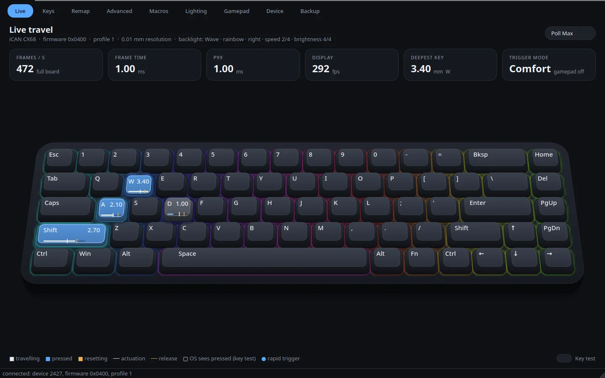

# cx68

Linux configurator, live analog HUD and gamepad bridge for the iCAN CX68 Hall-effect keyboard.

## Table of Contents

- [About](#about)
- [Screenshots](#screenshots)
- [Features](#features)
- [Technologies](#technologies)
- [Setup](#setup)
- [Usage](#usage)
- [Project Status](#project-status)
- [Credits](#credits)
- [Author](#author)

## About

A native replacement for the vendor's web configurator (`app.qmk.top` → `iotdriver.qmk.top`) for the **iCAN CX68** (= CamelTech CT-M68, Rongyuan RY5088, USB `3151:502d`). The official configurator runs over WebHID, which is tedious to set up on Linux and has no analog input. I made this for a better way to configure the keyboard, and to use its analog keys as a controller in racing games.

## Screenshots



*Captured against the repo's simulated keyboard (`tests/fakes.py`), so the frame-rate figures aren't from real hardware.*

## Features

- Live 3D view of how far each key is pressed
- Per-key actuation point, release point, rapid trigger and deadzones
- Remapping on the base and Fn layers (including media, system and mouse keys)
- Snap tap, toggle, mod-tap and DKS
- Macros, recorded or built
- Lighting and profiles
- Backup, compare and restore of every setting
- Gamepad bridge
  - A virtual Xbox 360 controller driven by key travel (or a generic pad)
  - Adjustable deadzones, response curves and per-key calibration
  - Only present while an allowed game is running (program allowlist, see [`docs/gamepad.md`](docs/gamepad.md))
- Never sends firmware, bootloader or reset commands

### Safety

Every packet goes through `cx68/policy.py`, which enforces the table in `cx68/commands.json`:

- **Never sent:** factory reset, bootloader/DFU entry, firmware upgrade, flash erase,
  calibration writes, unknown opcodes, and packets with the wrong checksum type.
- **Read-only by default.** Writes need `Device(mode="write")`. The live-travel stream
  toggle needs `Device(allow=[0x1B])`.
- **One process at a time:** the device is `flock`ed, and a second `cx68` process is refused.

## Technologies

- Python 3.11 or later (developed on 3.14, see [`docs/hardware.md`](docs/hardware.md))
  - `cx68/` protocol library: standard library only, no third-party dependencies. Needs 3.10+ (`X | None` type hints).
  - `cx68app/` desktop app and HUD. Needs 3.10+.
  - `cx68bridge/` gamepad bridge (uinput). Needs 3.11+ (`tomllib`).
- PySide6 6.4 or later for the GUI (installed with `pacman`, see Setup)
- Tested: the unit tests pass on Python 3.11, 3.12 and 3.14. On Python 3.11 the app starts with PySide6 6.4, 6.5, 6.6, 6.7 and 6.8, and opens every tab without errors on 6.4. It also runs on 6.12.
- OpenGL for the default renderer, with a CPU fallback
- JavaScript (ESM) in `tools/capture/`, development tooling only:
  - playwright 1.49.1
  - prettier 3.3.3
- Linux hidraw, udev, uinput and a systemd user service
- Tests: `unittest` (Python), plain Node script for the capture policy

### How it's put together

The app polls the keyboard in a separate process (`cx68-poller`), so drawing never slows polling down. The view renders with OpenGL, vsync off, redrawing at up to 240 fps on a fixed timer. Key colours are modelled from your settings: the keyboard reports travel, not whether it counts a key as pressed. The backlight preview approximates the configured effect.

Protocol details are in [`docs/protocol.md`](docs/protocol.md), hardware discovery in [`docs/hardware.md`](docs/hardware.md).

## Setup

### Prerequisites

- Linux with hidraw/udev access (the instructions below are for CachyOS / Arch)
- The iCAN CX68 keyboard
- Python 3.11 or later
- PySide6 6.4 or later for the GUI
- OpenGL for the default renderer (set `CX68_RASTER=1` for CPU rendering)
- A systemd user session for the gamepad bridge service

### Install

The bridge's systemd unit hardcodes `WorkingDirectory=%h/keyboard`, so keep the clone path below.

```bash
git clone https://github.com/areeb-ece/cx68-linux ~/keyboard; cd ~/keyboard
python3 -m cx68 info                  # needs read/write on /dev/hidraw* (see below)
```

The app needs PySide6:

```bash
sudo pacman -S --needed pyside6
```

The udev rules in `udev/70-cx68.rules` cover:

- hidraw access
- the phantom-joystick fix
- uinput for the gamepad bridge
- an optional, commented-out keyboard rule (read its trade-off before enabling it)

```bash
sudo install -m 644 udev/70-cx68.rules /etc/udev/rules.d/
sudo udevadm control --reload        # then unplug and replug the keyboard
systemctl --user link ~/keyboard/systemd/cx68-bridge.service   # gamepad bridge service
```

### Input data

Backups are JSON files written by `backup` to `backups/cx68-YYYYmmdd-HHMMSS.json` and read by `show`, `diff` and `restore`. Bundled data lives in `cx68/data/`.

### Tests

```bash
python3 -m unittest discover -s tests                     # library: replay harness, transport, backup, live
python3 -m unittest discover -s tools/capture -p 'test_*.py'
node tools/capture/test-policy.mjs
```

`tests/test_replay.py` regenerates every request the vendor page sent (captured, and
cross-checked against usbmon) from our builders, byte for byte, and decodes the captured
replies. The keymap, lighting, profile, advanced-mode, DKS and macro writers are built from the
vendor page's source and tested against a fake keyboard (`tests/fakes.py`) that models those
commands; their first run on the real board is still to come.

### Re-capturing after a firmware update

See `docs/protocol.md` §12. The tooling is in `tools/`:

| Tool | What it does |
|---|---|
| `hw_inventory.py` | sysfs-only interface map and report descriptors |
| `capture/iot_driver_shim.py` | Linux stand-in for the vendor's helper; logs and polices everything |
| `capture/capture.mjs` | Chromium with a WebHID logger (`app.qmk.top`) |
| `capture/usbmon.sh` + `crosscheck.py` | USB ground truth and byte-for-byte comparison |
| `capture/class_chain.py`, `dump_method.py` | opcode tables and method bodies from the vendor bundle |
| `capture/probe_travel.py`, `probe_stream.py` | standalone analog probes |

## Usage

### Command line

```bash
python3 -m cx68 info                  # id, firmware, active profile, mode, gamepad bit, other openers
python3 -m cx68 backup                # full read-only backup -> backups/cx68-<time>.json
python3 -m cx68 show backups/cx68-….json
python3 -m cx68 diff backups/cx68-….json      # what changed since the backup (reads only)
python3 -m cx68 restore backups/cx68-….json   # writes back per-key HE settings + mode, then verifies
python3 -m cx68 watch                 # live per-key depth by polling (read-only, ~900–950 frames/s)
python3 -m cx68 stream --seconds 20   # live depth via the firmware's notification stream
```

### App

```bash
python3 -m cx68app                    # live view, per-key settings, backup/restore
env CX68_RASTER=1 python3 -m cx68app  # CPU rendering instead of OpenGL, if GL misbehaves
```

### Library

```python
from cx68 import Device, config, live
with Device() as dev:                          # read-only, exclusive
    cfg = config.read_full_config(dev)
    config.save(cfg, "backup.json")
    for frame in live.poll(dev):               # reconnects after unplug/replug
        print(frame.travel[14] * 0.01, "mm")   # slot 14 = W
```

### Gamepad bridge

Details: [`docs/gamepad.md`](docs/gamepad.md).

```bash
python3 -m cx68bridge check           # permissions, config, phantom joystick, allowlist
python3 -m cx68bridge run             # or the systemd user service / the app's Gamepad tab
python3 -m cx68bridge calibrate       # rest and full-press travel of the mapped keys
python3 -m cx68bridge measure         # latency breakdown
python3 -m cx68bridge config
```

## Project Status

**In progress.** Phases 1 to 5 are built:

| Phase | Status |
|---|---|
| 1. Hardware discovery | done: [`docs/hardware.md`](docs/hardware.md) |
| 2. Protocol capture | done: [`docs/protocol.md`](docs/protocol.md) |
| 3. Protocol library (`cx68/`) | reads, live travel, verified writes for travel, keymap (incl. media / system / mouse keys), Fn, lighting, profile, advanced modes (snap tap, toggle, mod-tap, DKS), macros; backup/diff/restore of all of them |
| 4. Desktop app + HUD (`cx68app/`, PySide6) | live view, per-key travel, remap (base + Fn), snap tap / toggle / mod-tap / DKS, macros (record or build), lighting, profiles, backup/restore, gamepad control |
| 5. Gamepad bridge (`cx68bridge/`) | uinput pad (Xbox 360 or generic), curves/deadzones/calibration, program allowlist: [`docs/gamepad.md`](docs/gamepad.md) |

### Still to come

**Fix first**

- Empty macro slots. The real keyboard fills unused macro slots with `FF` bytes, where the
  simulated keyboard uses zeros. Those slots show up as junk macros in the Macros tab,
  make backups read far more macro data than they need to, and can make a restore fail
  with a "too long" error.

**Testing on the real keyboard.** The writers below are built from the vendor page's
source and tested against the simulated keyboard, but haven't all been confirmed on real
hardware yet:

- Remapping, on the base and Fn layers, including media, system and mouse keys
- Lighting
- Switching profiles
- Advanced modes: snap tap, toggle, mod-tap and DKS
- Macros on a key: assigning one, playing it, and restoring the key
- A full restore from a backup
- The latency test with real key presses (`python3 -m cx68bridge measure`)
- In-game checks of the gamepad bridge, such as a racing game's wheel mode with separate
  steering, throttle and brake

**Not built yet**

- The keyboard's own gamepad mode. Turning it on needs a write that hasn't been tried
  yet; the bridge's virtual controller covers this for now.
- Setting the 8000 Hz report rate. How the vendor's configurator sets it isn't known yet.
- A recording of the vendor's configurator making changes, to check this project's
  writes against it byte for byte.
- An installer that adds the app to the desktop's app launcher.

**Gaps in the app**

- Mouse wheel, mouse movement and gamepad actions can't be edited on a key yet, and
  macros can't contain media keys.
- A macro can only be removed by taking it off its keys, so a restore can't clear a
  macro that was created after the backup.
- The brightness range of 0–4 is an assumption that hasn't been checked.

## Credits

The protocol was derived from the vendor's web configurator (`app.qmk.top`); see section 2 of [`docs/protocol.md`](docs/protocol.md).

## Author

Made by areeb ([areeb-ece.github.io](https://areeb-ece.github.io), [GitHub](https://github.com/areeb-ece)).
